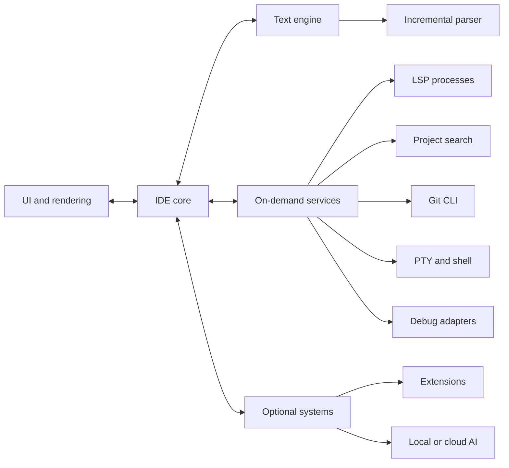

# LightLine: technical direction

Status: architecture written 2026-09-17 for v0.1. Current state, technology table and roadmap refreshed for v0.8.0 on 2026-11-07.

This document records the intended product and the boundaries we want to preserve as the project grows. Individual libraries, data structures, and performance targets remain open to measurement. Where a section describes what exists today, it says so; everything else is direction, not a claim that the subsystem already exists.

> Do the minimum amount of work necessary, at the latest possible time, without blocking the user's interaction.

## Product goal

Build a native, lightweight, highly responsive developer environment where complexity is opt-in. The editor must remain useful when language servers, Git, indexing, plugins, and AI are inactive. Fast idle behavior, predictable resource use, and low interaction latency are product requirements.

We begin with a real text editor and grow it into a code editor and then an IDE. We should not build a throwaway editor, nor should we build the entire IDE before basic editing is reliable.

```text
Text editor → Code editor → Project editor → IDE
```

## System boundaries



The UI owns pixels, layout, input events, and the visible viewport. The core owns commands, workspaces, editor state, configuration, and sessions. The text engine owns documents, editing operations, cursors, selections, and undo/redo. Background services own expensive or external work. Optional systems must be removable without breaking basic editing.

The text model must not depend on pixel coordinates or a particular GUI toolkit. Rendering consumes a view of document state and paints only the visible region. Tabs and split panes are views of documents; they must not create independent copies of the same file's contents.

Ownership and state changes need explicit rules. UI commands change core state; work that can finish later returns versioned results so stale parsing, search, or LSP responses cannot overwrite newer document state. Rust prevents many memory-safety errors, but it will not prevent duplicate buffers, unbounded caches, unnecessary copies, or a confused ownership model.

### Current code organization

The code is two crates in one package. The library crate (`src/lib.rs`, crate `lightline`) holds everything that doesn't touch a window: the text model (`document.rs`), syntax (`syntax.rs`), the LSP and DAP clients (`lsp.rs`, `debug.rs`), terminals (`terminal/`), runners, formatters, settings, search, Local History, extensions, AI and workspace services (`workflow.rs`). It is meant to stay portable, so Win32 calls there are limited to `terminal/platform.rs`, `clipboard.rs`, `credentials.rs` and `jobs.rs`.

The binary crate (`src/main.rs` and `src/windows_app/`) is the whole Windows UI. `src/main.rs` is only the entry point; `window.rs` owns window creation and Win32 message routing, `app.rs` owns all editor state in one `App` struct, and `input.rs` handles keyboard and mouse actions. Each feature (find, merge conflicts, debugger, minimap, AI chat and so on) lives in its own file that adds an `impl App` block. Rendering lives under `render/`, with editor painting, panel painting, and shared GDI primitives in separate files. This is a responsibility split rather than a line-count rule; the UI still shares one `App` state and can be refined as new features make ownership boundaries clearer. `ARCHITECTURE.md` has the subsystem diagram.

## Technology direction

| Area | Direction | Status in v0.8.0 |
| --- | --- | --- |
| Primary language | Rust for the core, editor, UI, services, and performance-critical code | Stable principle |
| Target platform | Windows 10 and 11, x64 and ARM64 | In use. macOS is not planned for now (issue #35); the portable path is kept in [macOS support](#macos-support) |
| UI | Self-drawn through Win32, no GUI toolkit | In use. GPUI was the first candidate and was not adopted |
| Rendering | GDI into a persistent backbuffer; redraw only the invalid region; scroll by moving rows in the backbuffer | In use. `tiny-skia` + `softbuffer` is the portable replacement if a port happens |
| Text buffer | One `String` per line (`Vec<String>`), files up to 128 MB | In use. Benchmarked up to 121 MiB ([results](TEXT_MODEL_BENCHMARK.md)): kept, because typing costs about 1 µs at every size. If line-splitting edits in very large files need to get faster, chunk the lines rather than switch to a byte rope |
| Syntax parsing | Tree-sitter with incremental edits, on a worker thread | In use for Rust, Python, C and C++ (C grammar), JavaScript, TypeScript/TSX and JSON; Markdown has its own highlighter |
| Language intelligence | Existing language servers through LSP | In use: rust-analyzer, Pyright, clangd, typescript-language-server, gopls |
| Debugging | Debug Adapter Protocol | In use: lldb-dap for native code, debugpy for Python |
| Search | In-process, bounded file walk with in-process `.gitignore` rules and `regex` matching | In use. ripgrep was the plan; it isn't needed so far |
| Git | Git CLI behind a Git service | In use |
| Terminal | ConPTY with a `vt100` model | In use: PowerShell, Command Prompt, Git Bash, WSL |
| Concurrency | OS threads that wake the window with a posted message; no async runtime, no polling timers | In use |
| Network | Only when the user acts: `ureq` for the extension registry, AI and allowed Markdown web images; Git, npm and pip processes for Git remotes, extension installs, the Pyright download and **Python: Install debugpy** | In use; no telemetry |
| Persistent cache | SQLite only if a measured need for persistent indexing appears | Not needed so far |
| Zig | Consider only for a measured bottleneck with a meaningful improvement | Not needed so far |
| AI | Optional, opt-in HTTP chat with any OpenAI-compatible server | In use. Ollama by default; keys in Windows Credential Manager |
| Extensions | Catalogue from the Zed extension registry, consumed through adapters | Partly in use: color and icon themes, and syntax colors from language extensions (the grammar is compiled with the user's C compiler at install). Language servers from extensions and extensions that run code are not supported |

Rust is the default throughout: native binaries, memory safety, concurrency, and a strong developer-tooling ecosystem fit a long-running editor. We do not add another systems language merely because it is fast. A Zig component would require profiling, an alternative implementation, a benchmarked gain, and a justified FFI boundary.

GPUI was the first framework we planned to investigate. The Win32 and GDI window that started as a prototype turned out fast to start, cheap per keystroke and quiet when idle (see [Performance discipline](#performance-discipline)), so it became the UI and GPUI was never adopted. The decision stays open to evidence: a different renderer replaces GDI only if it matches or beats it on the same machine (see step 3 of the [macOS plan](#macos-support)).

## Text engine and rendering

Separate these responsibilities:

```text
Text model: buffer, cursor, selection, undo/redo, edit operations, file state
Rendering: layout, glyphs, syntax colors, cursor, selection, viewport
```

The buffer was benchmarked from 3,000 lines up to 121 MiB (`examples/measure_text_model.rs`; results and method in [TEXT_MODEL_BENCHMARK.md](TEXT_MODEL_BENCHMARK.md)). `Vec<String>` stays: typing a character costs about 1 µs at every size, and 114 call sites read the text a line at a time. Its one structural weakness is that Enter, a Backspace that joins lines and multi-line paste move every line below the edit, which exceeds the 3 ms keystroke budget above about 650,000 lines. If that starts to matter, store lines in chunks of about 1,024 (which keeps line access) rather than switching to a byte rope. Re-run the benchmark before changing the model.

Only visible lines should be laid out and painted. A 100,000-line document must not create 100,000 UI widgets. Scrolling changes the viewport and requests work for the newly visible area. Long lines, wrapped lines, selections, cursor movement, and syntax colors need their own measurements; a GPU alone does not guarantee low latency.

Text correctness is foundational. UTF-8 bytes are not characters, and characters are not always user-perceived graphemes. Combining marks, emoji, CJK text, bidirectional text, font shaping, input methods, and LSP position encodings affect cursor movement and selection. File handling must also account for encodings, line endings, external changes, reliable saving, and permissions. Large files may need lazy loading, bounded parsing, and a different line-index strategy.

## Parsing and language support

Tree-sitter maintains syntax trees incrementally on a worker thread. A small edit updates affected regions instead of reprocessing an entire document: only edited lines and the tree's changed ranges are recolored. The parser consumes document revisions and publishes highlighting only for the revision it parsed. Files over the `parseLimitKb` setting (4 MB by default) are shown without colors; Rust files over 128 KB use a bounded lexical fallback instead. Syntax parsing is distinct from language intelligence.

LSP is the boundary to existing language servers. The client started with one language and added others as it proved reliable:

| Language | Server |
| --- | --- |
| Rust | rust-analyzer |
| Python | Pyright (downloaded on request) |
| C/C++ | clangd |
| JavaScript/TypeScript | typescript-language-server |
| Go | gopls |

The client provides diagnostics, completion, hover, signature help, inlay hints, definition, references, rename, code actions, document and workspace symbols, and formatting. Servers launch only when a relevant file or command needs them, with one client per language and workspace root. A slow or memory-hungry server must not make typing or scrolling slow. The core must handle server crashes, delayed messages, document versions, cancellation, and position-encoding conversions.

## Project and developer services

Workspace and project loading should be lazy. Opening a project should not trigger a full scan or index before the editor becomes usable. File trees, recent files, project search, and workspace state can appear progressively. File watching, symlinks, case sensitivity, permissions, and path semantics vary by operating system; Windows is the first platform to handle well.

Project search runs in-process on a background thread: a bounded walk of the workspace (it stops a runaway walk, not ordinary projects) that applies `.gitignore` rules itself, because starting `git` for them costs about 50 ms, and matches with the `regex` crate. ripgrep was the original plan; it would only come back if measurements on large workspaces call for it. A persistent index is a later, measured choice. Git is a service around the Git CLI; there is no reason to reimplement Git. Build, run, and debug came after the editor and project features: each language runs with the toolchain already installed on the user's PC, and debugging uses lldb-dap and debugpy through DAP.

The terminal uses ConPTY with a `vt100` model, with PowerShell, Command Prompt, Git Bash and WSL profiles. bash and zsh matter when other platforms are supported. PTY behavior is platform-specific and stays behind a service boundary (`terminal/platform.rs`).

Every child process (language servers, debug adapters, formatters, runs, git clones) goes into a kill-on-close job object, so none outlive LightLine.

Expensive work must not block the UI thread. Project scans, search, Git commands, indexing, parsing that exceeds the interaction budget, and language-server communication run in background workers. Use async or threads where they help, not as a blanket design rule. Workers must have bounded queues, cancellation, and ownership rules so concurrency does not turn into uncontrolled background activity.

SQLite is activated only if persistent incremental indexing or another measured need justifies it. Small projects should not pay startup, memory, or disk costs for an index they never use.

## Optional systems and isolation

AI is outside the core. With AI disabled, the editor starts no AI process, model, embedding job, context index, or agent. Today the AI Assistant is an HTTP chat with any OpenAI-compatible server, local (Ollama by default) or cloud (OpenAI, OpenRouter, Groq and others); it uses the network only when the user asks, and API keys live in Windows Credential Manager, never in LightLine's files. No core editing operation may depend on AI being available.

Extensions come from the Zed extension registry rather than a marketplace of our own (`docs/extension_implementation_plan.md` has the reasons). Today only data-only extensions work: color themes and icon themes. They are fetched at a pinned commit into a staging folder, checked, and moved into place with a backup. Extensions that run code, such as Zed's WASM extensions, need an adapter and isolation first. Plugins use a defined API and controlled capabilities. Potentially expensive or untrusted plugins should run in isolated processes so a plugin crash does not crash the editor. IPC and process isolation have costs, so the design and permissions come later. Plugins must not receive unlimited access to the core merely for convenience.

Subsystem failures must be contained: a failed language server, search process, plugin, or AI feature should leave documents editable and savable.

## Performance discipline

Performance is a constraint on each architectural decision, not a cleanup phase. We do not initialize unnecessary systems at startup, redo unaffected work after a local edit, or run expensive operations on the UI thread. We benchmark before optimizing and compare before/after measurements on the same hardware and workload.

| Measure | Target | Last measured (v0.8.0, x64 release build) | Scenario to record |
| --- | --- | --- | --- |
| Cold and warm startup | TBD | About 0.13 s to a responding window | Process launch to usable editor |
| Idle memory and CPU | TBD | Not recorded | Empty window and open project after settling |
| Typing latency | TBD | About 7.5 M CPU cycles on the UI thread per keystroke; about 2–3 ms key to screen (README) | Key event to visible paint, including tail latency |
| Scrolling | TBD | Repaint correctness checked in debug builds; cost not recorded per release | Frame times in small and large files |
| File open | TBD | Document-only numbers from `examples/measure.rs` | 10 KB, 100,000 lines, and very large files |
| Search | TBD | Not recorded | Query to first and complete results in representative projects |
| Project loading | TBD | Not recorded | Time until usable in a 100,000-file workspace |
| Background activity | TBD | About 1 wakeup a second after the window icons fix (was about 2 on v0.7.0 and v0.8.0). The rest is another program polling every window with `WM_GETICON`; LightLine runs no timers of its own while idle | CPU, disk I/O, and processes while idle |

Targets remain TBD until we benchmark existing editors and target hardware. Record hardware, OS scaling, file/project fixtures, cold versus warm runs, and percentiles where latency matters. Each release is compared with the previous one on release builds, on the same PC and workload (a 3,148-line Rust file with rust-analyzer running), and the results go in its `CHANGELOG.md` section. The document-only measurements in `examples/` are not a UI latency budget. A 500 MB file is a distinct workload that will need bounded memory and work, not merely the same path with a larger input.

How to measure: compare `QueryThreadCycleTime` rather than wall-clock time, which swings with load; count wakeups per thread (context switches) with the window unfocused so the caret blink doesn't count; time paints with a temporary `WM_PAINT` logger. Debug builds answer `WM_APP+97` with the number of backbuffer pixels that differ from a full redraw.

## Roadmap

Version labels describe sequence, not release promises. The stage order matters more than the numbers.

### Original sequence (done)

This was the plan written for v0.1. Releases did not follow the numbers one to one (the terminal and the debugger had shipped by v0.2.0, well ahead of their slots), but by v0.8.0 every stage has shipped, except that the plugin system is so far limited to data-only extensions.

| Stage | Intended scope | Status in v0.8.0 |
| --- | --- | --- |
| v0.1 | Native window, correct text editing, files, open/save, tabs, search, syntax highlighting | Done |
| v0.2 | Project/workspace, file tree, recent files | Done |
| v0.3 | Scale Tree-sitter parsing beyond small files and expand language coverage | Done: worker thread, incremental edits, seven grammars |
| v0.4 | LSP client and one language server first | Done: five servers |
| v0.5 | Git CLI integration and terminal | Done |
| v0.6 | Debugger | Done: lldb-dap and debugpy |
| v0.7 | Isolated plugin system | Partly: themes and icon themes from the Zed registry; no extensions that run code |
| v0.8 | Optional AI subsystem | Done |

### Next stages (proposed)

These are proposals for the maintainer to accept, reorder or drop, in suggested order. None has a date.

| Order | Stage | Intended scope | Decision rules it serves | State |
| --- | --- | --- | --- | --- |
| 1 | Keep the performance budget honest | Fill in the "Last measured" column above for every release, including idle memory, scrolling and search, and compare each release with the previous one before it ships. Next from the text-model benchmark: count Find matches without rescanning the whole file on every typed character, and move saving off the UI thread | 2, 4, 5, 8 | Ongoing. The idle wakeups are explained and halved (see above) |
| 2 | Benchmark the text model | Measure typing, line access, undo memory, search, open and save from small files up to the 128 MB limit. Change the model only if the gain is real on real workloads | 3, 6, 8 | Done: `Vec<String>` kept ([results](TEXT_MODEL_BENCHMARK.md)); typing on very long lines now edits in place |
| 3 | Language extensions from the Zed registry | Load Tree-sitter grammars and language configuration from Zed language extensions, only when a file needs them, so more languages get colors without growing the exe. Then comments, brackets and indentation from the extension, the new languages in the language picker, and letting an extension name the language server to start, still spoken to by LightLine's own LSP client | 2, 7 | First step done: grammars compiled at install, syntax colors from `highlights.scm`. The rest is not started |
| 4 | Code signing | Sign release builds through SignPath (already wired into `release.yml`, off until `SIGNPATH_ENABLED` is set) so SmartScreen stops warning; closes issue #13 | 9 | Waiting on SignPath approval |
| 5 | Extensions that run code | A WASM adapter (Zed's extensions target `wasm32-wasip2` with `wasmtime`) or separate processes, with explicit capabilities, so a broken extension can't stall typing or crash the editor | 1, 7 | Not started; depends on 3 |
| 6 | Another platform | Only if the maintainer revives issue #35. Follow the [macOS plan](#macos-support); its step 1 (a `Canvas` trait in front of GDI) should cost nothing measurable on Windows before it lands | 9, 10 | Not planned |

Still outside the plan: cloud sync, collaboration, a marketplace of our own, a persistent project index (until search measurements need one), and a built-in package manager.

### Current implementation (v0.8.0)

LightLine is a single portable `.exe` for Windows 10 and 11 on x64 and ARM64. It has tabs, two split panes that can show the same document (each with its own cursor, selection and scroll; text and undo history are shared), multiple cursors, snippets, word wrap, sticky scroll, bracket colors, a minimap, Find and Replace with Match Case, Whole Word and regular expressions, project search and Replace in Files, Quick Open with command, symbol and go-to-line modes, and a lazy Explorer. Cursor movement and deletion are grapheme-aware, and multi-step edits undo in one step.

Tree-sitter colors Rust, Python, C and C++, JavaScript, TypeScript, TSX and JSON on a worker thread with incremental edits and revision-checked results; Markdown has its own highlighter and a rendered preview. Language servers (rust-analyzer, Pyright, clangd, typescript-language-server, gopls) start only when a file of that language opens, and typing continues if one is slow or crashes. External formatters (Prettier, rustfmt, Ruff or Black, clang-format) run as processes, and format-on-save runs after the save rather than blocking it.

Each language runs with the user's own toolchain from a ▶ Run link or `Ctrl+Shift+R`, in an Output pane that accepts input; saved run configurations live in `.lightline/run.json`. The debugger offers breakpoints, stepping, variables, call stack and a Debug Console through lldb-dap and debugpy. The integrated terminal uses ConPTY with PowerShell, Command Prompt, Git Bash and WSL.

Git support goes through the Git CLI: status, staging (including single hunks), commit, branches, push, pull and fetch, a review diff, gutter marks, inline blame, and merge-conflict resolution in the editor. Local History keeps a copy of every save. Session restore reads only the visible tab at startup and keeps unsaved text for recovery after a crash. Color and icon themes install from the Zed registry. The AI Assistant is optional and talks to any OpenAI-compatible server.

Background work runs on threads that wake the window with a posted message; there are no polling timers. The only repeating timer is the caret blink while the window has focus; the rest (session recovery snapshot, status bar, debounces) fire once. Every child process dies with LightLine through a kill-on-close job.

## macOS support

**Status: not planned for now.** Issue #35 is labelled `wontfix` and left open so people can find it. This section keeps the plan so that, if a port happens, it doesn't start from scratch.

LightLine runs only on Windows because its UI layer, `src/windows_app/`, is written directly against Win32: window creation, GDI drawing, and mouse and keyboard messages. The library underneath is mostly portable already: the text document, Tree-sitter syntax, LSP client, Git, debugger protocol, formatters and Markdown. Only a few library pieces are Windows-specific: the ConPTY terminal, the clipboard, API keys in Windows Credential Manager (`credentials.rs`), the kill-on-close job object for child processes (`jobs.rs`), and `%APPDATA%` and `\\?\` paths.

**Approach: keep painting everything ourselves, on a cross-platform base.** LightLine already draws every pixel itself, so the port swaps the platform layer under that painting rather than adopting a widget framework:

| Today (Windows only) | Portable replacement |
| --- | --- |
| Win32 window and message loop | `winit` |
| GDI drawing into a backbuffer | `tiny-skia` (already used for SVG icons), presented with `softbuffer` |
| GDI text output and measurement | `cosmic-text` for shaping, layout and glyphs |
| ConPTY terminal | `portable-pty` (ConPTY on Windows, a Unix PTY on macOS) |
| Win32 clipboard | a cross-platform clipboard crate |
| `%APPDATA%`, `\\?\` paths | a per-platform config folder (`~/Library/Application Support` on macOS) |
| Windows Credential Manager | the platform keychain (Keychain on macOS) |
| Kill-on-close job object | process groups, killed on exit |

This keeps one codebase, the current look and the same performance model (redraw only what changed), and brings Linux nearly for free. It replaces the GPUI idea from the original plan (never adopted; see [Technology direction](#technology-direction)) as the path off Windows-only.

**Steps, each one shippable on its own:**

1. **A drawing interface in front of GDI.** Route every fill, line, text and image call through a small `Canvas` trait implemented with GDI. There is no visible change on Windows, and every paint path stops depending on Win32 directly.
2. **Platform services behind interfaces.** Do the same for the window and input events, clipboard, file dialogs, cursors, timers and the config folder.
3. **The portable backend, on Windows first.** Implement `Canvas` with `tiny-skia` and `cosmic-text`, and the window with `winit`. Compare startup, memory, typing latency and scrolling against GDI on the same machine; switch only when it matches or beats GDI.
4. **The terminal on `portable-pty`**, with zsh and bash as the macOS shells.
5. **The macOS build.** Menus and shortcuts (`Cmd` for `Ctrl`), Retina scaling, and a `.app` bundle. Add a `macos-latest` job to CI and a macOS release asset.
6. **Signing and notarization.** An Apple Developer account ($99 a year) is required; without it, macOS blocks the app more strictly than SmartScreen does.

**Needs:** a Mac to develop and test the UI on (GitHub's macOS runners can build and test, but not judge look and feel), and the benchmarks in [Performance discipline](#performance-discipline) recorded before and after step 3.

Other options considered: a separate native AppKit frontend (the most native feel, but two UIs to maintain), a Rust GUI framework such as GPUI, `iced`, `egui` or Slint (close to a full UI rewrite), and Tauri or Electron (fastest to ship, but it gives up the small, fast footprint that defines LightLine).

## Decision rules

1. Keep basic editing useful and responsive without optional services.
2. Start a subsystem only when a user action or open document needs it.
3. Update only affected state when a document changes.
4. Keep slow work off the UI thread and discard stale results.
5. Bound memory, queues, caches, and background work.
6. Keep text state separate from rendering and external integrations.
7. Isolate optional and failure-prone components.
8. Benchmark on real workloads before choosing data structures, frameworks, or optimizations.
9. Make Windows reliable first; expand platforms deliberately.
10. Revise library choices when evidence changes, while preserving these boundaries.
